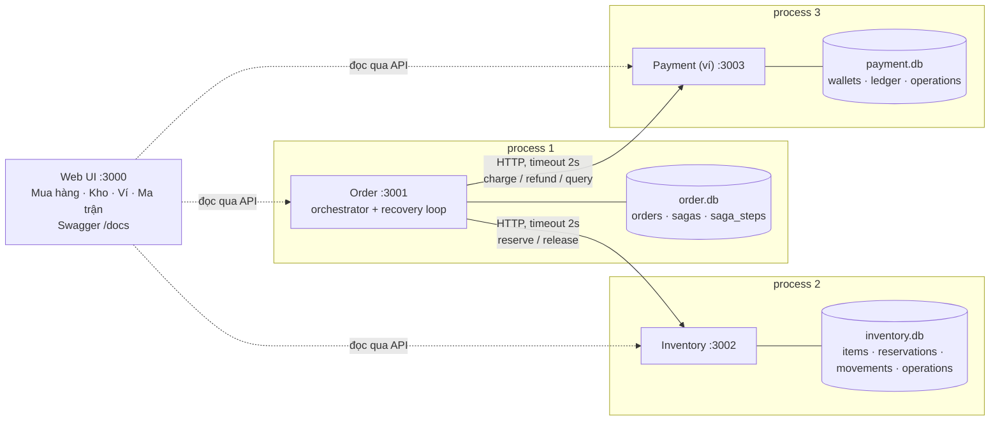

# REPORT — Block 7: Giao dịch phân tán và Saga (Checkout Saga)

Nhóm 07 · 23127045 · 23127102 · 23127159 · 23127183 · 23127393

Báo cáo này giải thích **các lựa chọn của nhóm dẫn tới kết quả cuối cùng**: chọn gì, không chọn gì, vì sao, và chấp nhận đánh đổi nào. Mọi con số đều lấy từ lượt chạy thật, lưu trong [evidence/](evidence/). Bản trình chiếu là [REPORT.html](REPORT.html): gồm bộ slide thuyết trình cộng thêm phần slide giải thích từng lựa chọn, mở offline được, có chế độ **Đọc tài liệu** kèm giải thích từng slide. Đối chiếu từng yêu cầu của đề với nơi hiện thực nằm ở [AUDIT.md](AUDIT.md). Hướng dẫn triển khai: [README.md](README.md).

## Mục lục

1. [Kết quả cuối cùng](#1-kết-quả-cuối-cùng)
2. [Bài toán và phạm vi](#2-bài-toán-và-phạm-vi)
3. [Kiến trúc tổng thể](#3-kiến-trúc-tổng-thể)
4. [Các lựa chọn và lý do](#4-các-lựa-chọn-và-lý-do)
5. [Bảng tóm tắt lựa chọn](#5-bảng-tóm-tắt-lựa-chọn)
6. [State machine và policy trạng thái](#6-state-machine-và-policy-trạng-thái)
7. [Quá trình V1 → V3](#7-quá-trình-v1--v3)
8. [Kiểm thử và evidence](#8-kiểm-thử-và-evidence)
9. [Phân tích lỗi và rủi ro](#9-phân-tích-lỗi-và-rủi-ro)
10. [Giới hạn và hướng phát triển](#10-giới-hạn-và-hướng-phát-triển)
11. [Trả lời câu hỏi kết thúc](#11-trả-lời-câu-hỏi-kết-thúc)
12. [Kết luận](#12-kết-luận)
13. [Phụ lục](#phụ-lục-a-thư-viện-và-phiên-bản)

## 1. Kết quả cuối cùng

| Đại lượng | Baseline (gọi tuần tự, không Saga) | Bản nộp | Minh chứng |
| --- | --- | --- | --- |
| Confirm lỗi sau khi đã thu tiền | Đơn rollback, **hàng vẫn bị giữ, khách mất 350.000đ** | CANCELLED, refund đúng 1 lần, hàng về kho, **khách không mất tiền** | [baseline.txt](evidence/baseline.txt), [F3](evidence/F3/timeline.txt) |
| Kịch bản H0, F1–F6 đạt oracle của đề | — | **7/7**, tổng **48/48** check | [SUMMARY.md](evidence/SUMMARY.md) |
| Automated test | — | **30/30** (4 suite unit + 3 suite tích hợp trên process thật) | [test-output.txt](evidence/test-output.txt) |
| Automated failure test bắt buộc (V1) | — | F1, F2, F3 + H0, assert cả 3 kho và toàn bộ ledger | `test/integration/saga.v1.test.js` |
| Kill Payment sau khi charge commit (F4) | Caller timeout, không biết đã thu chưa | **RECOVERING** khi Payment chết; hội tụ CONFIRMED **0,7–4 giây** sau khi start lại; **1 charge** | [F4](evidence/F4/timeline.txt) |
| Refund lỗi tạm thời (F5) | — | **COMPENSATING** với pending `[refund, release]` được lưu bền; gỡ lỗi → hội tụ **1,3 giây**; 1 refund | [F5](evidence/F5/timeline.txt) |
| Kill orchestrator tại khoảng hở (F6) | Mất trạng thái trong RAM | Restart cùng DB, PID mới, dùng lại op `S7:charge`, hội tụ **0,5 giây**; 1 charge | [F6](evidence/F6/timeline.txt) |
| Double charge / double refund trong mọi kịch bản | — | **0** (op ID + UNIQUE ở DB) | idempotency test, oracle |
| Terminal giả (CANCELLED khi còn pending, kết luận khi chưa biết) | — | **0** (guard trong state machine) | `test/unit/machine.test.js` |
| Tài liệu API khớp code | — | **26/26** route có trong OpenAPI; test đỏ nếu lệch | `test/unit/openapi.test.js`, `/docs` |
| Web UI 4 góc nhìn | — | Khách mua hàng, thủ kho, ví tiền, ma trận H0–F6 tự chấm oracle | http://127.0.0.1:3000 |

## 2. Bài toán và phạm vi

Checkout ghi vào ba DB độc lập: `Create Order → Reserve Inventory → Charge Payment → Confirm Order`. Khi confirm lỗi, transaction của Order không gỡ được charge đã commit ở Payment. Đề (slide 25–31) yêu cầu nhóm **tự xây** với coding agent:

| Phiên bản | Yêu cầu của đề | Nhóm làm |
| --- | --- | --- |
| V1 (automated) | State machine + điều kiện kết thúc; bù cho thất bại dứt khoát, refund trước release; H0 + 3 automated test F1–F3 assert cả ba kho; UI hiện đúng | `machine.js` (hàm thuần, guard), orchestrator, 4 test tích hợp, UI 4 tab |
| V2 (demo F4) | Dừng Payment sau commit, trước response; Order giữ RECOVERING; query cùng ID rồi confirm; không charge mới | Fault `charge.afterCommit=freeze` + marker + kill process thật; `doRecover()` query → gửi lại cùng op |
| V3 (demo F5, F6) | Kill orchestrator tại khoảng hở; refund lỗi tạm thời; phục hồi refund rồi release đúng một lần; evidence trước/sau | Intent bền trước mỗi lời gọi, resume khi khởi động, pending bền, backoff |

Ràng buộc: ba service HTTP, ba process, ba DB riêng; chỉ bind loopback; không broker, không đăng nhập, không cổng thanh toán thật.

Dữ liệu mẫu ([data/seed/](data/seed/)):

| Khách (ví) | Số dư | Sản phẩm | Giá | Tồn |
| --- | --- | --- | --- | --- |
| Nguyễn Văn An `CUS-AN` | 2.000.000đ | Tai nghe Bluetooth | 350.000đ | 10 |
| Trần Thị Bình `CUS-BINH` | 300.000đ | Bàn phím cơ | 900.000đ | 5 |
| Lê Minh Cường `CUS-CUONG` | 1.000.000đ | Chuột không dây | 200.000đ | 3 |
| | | Loa mini | 500.000đ | **0** |

Loa tồn 0 làm F1 xảy ra tự nhiên; Bình chỉ có 300.000đ làm F2 xảy ra tự nhiên.

## 3. Kiến trúc tổng thể

| Thành phần | File | Trách nhiệm |
| --- | --- | --- |
| State machine | `services/order/machine.js` | `apply(saga, event)` có guard, `nextAction`, `opId` |
| Orchestrator | `services/order/orchestrator.js` | intent → call → outcome, bù, RECOVERING, resume, recovery loop |
| Order API | `services/order/server.js` | Tạo đơn + saga trong 1 transaction, đọc đơn/saga, resume |
| Inventory | `services/inventory/server.js` | Reserve/release idempotent, tồn kho, lịch sử vào/ra, nhập hàng |
| Payment | `services/payment/server.js` | Ví, ledger chỉ INSERT, charge/refund idempotent, query operation |
| Dùng chung | `common/*.js` | SQLite + tx, HTTP có timeout, idempotency, fault hook, log + marker, oracle, snapshot |
| Công cụ lab | `scripts/lab.js`, `demo.js`, `scenarios.js` | Start/kill process thật, fault, snapshot, chạy kịch bản và ghi evidence |

## 4. Các lựa chọn và lý do

### 4.1 Ngôn ngữ, runtime và framework

> **Nhóm chọn JavaScript (CommonJS) trên Node.js 22 + Express 5.**
>
> - Đồng nhất với Block 5–6 nên tái dùng được kinh nghiệm và cấu trúc (`createApp` chung, test Jest).
> - Node 22 có sẵn `fetch` + `AbortSignal.timeout`, nên mọi lời gọi giữa service đều có timeout mà không cần thư viện HTTP.
> - Đơn luồng, event loop: điểm dừng "đóng băng cả process" (`Atomics.wait`) mô phỏng đúng một process bị treo; điều này quan trọng cho F4/F6.
> - Express 5 tự chuyển lỗi của handler `async` sang error middleware: `OpError` → HTTP status đúng ở một chỗ.
>
> **Không chọn:**
> - **Spring Boot**: mỗi service một JVM khởi động chậm (vài giây), làm demo kill/start kém mượt; cấu hình và annotation che mất cơ chế intent/outcome mà bài cần trình bày.
> - **NestJS**: thêm decorator, DI và build TypeScript cho khoảng 1.100 dòng logic; không thêm giá trị cho phần Saga.
> - **Go / Python FastAPI**: khác hệ sinh thái nhóm đã dùng; không có lợi thế riêng cho bài.
> - **TypeScript**: cần bước build cho mỗi lần start process; demo kill/start chạy thẳng `node services/...` đơn giản hơn.
>
> **Đánh đổi chấp nhận:** không có kiểm kiểu tĩnh; bù bằng hàm thuần `machine.js` có 16 unit test và test tích hợp trên process thật.

### 4.2 Giao thức phối hợp: Saga, không 2PC / 3PC

> **Nhóm chọn Saga**: mỗi bước là một local transaction commit ngay trong DB của service sở hữu; bước sau lỗi thì chạy compensation theo thứ tự ngược.
>
> - Payment (ví, cổng thanh toán) chỉ có `charge`, `refund`, `query`; **không có pha prepare**, nên 2PC không áp dụng được (slide 14).
> - 2PC: participant đã vote YES mà mất coordinator thì **in-doubt**, không được tự abort, phải giữ khóa hàng và tiền: **blocking** (slide 10–12).
> - 3PC chỉ không-blocking khi mạng đồng bộ và lỗi fail-stop; khi mạng bị chia cắt thì hai phía có thể quyết định ngược nhau (slide 13). Đề chỉ yêu cầu hiểu giới hạn, không cài đặt.
>
> **Không chọn:**
> - **2PC / XA** (JTA, MySQL XA, PostgreSQL `PREPARE TRANSACTION`): cần mọi participant hỗ trợ prepare; giữ khóa suốt hai vòng mạng; coordinator thành điểm gây blocking.
> - **3PC**: thêm một vòng mạng, vẫn không an toàn khi mạng bị chia cắt.
> - **Gộp ba bảng vào một DB**: trái yêu cầu ba service, ba DB riêng.
> - **Distributed SQL** (Spanner, CockroachDB): giải quyết atomic commit bên trong DB, nhưng không áp dụng được cho API của bên thứ ba như ví/cổng thanh toán.
>
> **Đánh đổi chấp nhận:** mất isolation (trạng thái trung gian nhìn thấy được), nhất quán **theo thời gian**, phải thiết kế compensation cho từng bước.

### 4.3 Kiểu điều phối: orchestration trong Order

> **Nhóm chọn orchestration**: orchestrator chạy trong process Order, ghi Saga record vào Order DB.
>
> - Một nơi quyết định bước tiếp theo nên dễ quan sát: đọc bảng `sagas` là biết đơn đang ở đâu, còn nợ việc gì.
> - Saga record nằm **cùng DB** với đơn, nên đổi `orders.status` và Saga record trong **một local transaction** (`persist()`): hai thứ không bao giờ lệch nhau.
> - Test chỉ cần chờ trạng thái terminal rồi assert ba kho.
> - Lab chưa có broker (đề ghi rõ broker và outbox thuộc block sau).
>
> **Không chọn:**
> - **Choreography** (service phát/nghe sự kiện): cần broker; flow rải rác trong ba service, khó theo dõi nhánh F3/F5.
> - **Workflow engine** (Temporal, Camunda/Zeebe, AWS Step Functions): làm sẵn đúng phần bài muốn sinh viên tự hiểu (state bền, retry, resume); thêm hạ tầng nặng.
> - **Thư viện Saga** (Axon, Eventuate Tram, MassTransit): thuộc hệ Java/.NET, cần broker.
> - **Orchestrator là service riêng (process thứ 4)**: thêm một ranh giới DB nữa giữa saga và đơn, khiến việc đổi trạng thái đơn và saga không còn nằm trong một transaction.
>
> **Đánh đổi chấp nhận:** Order vừa là service nghiệp vụ vừa là orchestrator; chỉ một instance (mục 4.12).

### 4.4 Cơ sở dữ liệu: SQLite, mỗi service một file

> **Nhóm chọn SQLite qua `better-sqlite3`, mỗi service một file:** `data/order.db`, `data/inventory.db`, `data/payment.db`.
>
> - Ba file là **ba DB độc lập thật**: service này không thể mở transaction trên file của service kia.
> - Dữ liệu nằm trên đĩa: kill process thì dữ liệu đã commit vẫn còn; "restart cùng DB" chỉ là chạy lại process (F6), không phải dựng lại container.
> - Không cần Docker hay server DB: chạy được trên Windows của cả nhóm và máy chấm chỉ với `npm ci`.
> - `db.transaction(fn)` của better-sqlite3 đồng bộ, tự ROLLBACK khi `fn` ném lỗi: không thể quên ROLLBACK, và trong một process không có hai request xen giữa một transaction.
> - Mỗi DB chỉ có **một process ghi**, nên giới hạn "một writer" của SQLite không ảnh hưởng.
> - Snapshot evidence đọc được file DB ở chế độ **read-only** khi service đang chết (chứng minh "Payment đã commit C4 dù đang chết").
>
> **Không chọn:**
> - **PostgreSQL / MySQL qua Docker**: gần production hơn nhưng thêm ba container hoặc ba database, connection pool, thời gian khởi động; không giúp gì cho phần được chấm (Saga, phục hồi).
> - **`node:sqlite`** (có sẵn trong Node 22): vẫn ở mức experimental, in cảnh báo khi chạy; không có helper `transaction()`. Nhóm giữ làm phương án dự phòng.
> - **In-memory** (như Block 6): kill process là mất dữ liệu, không làm được F4/F6.
> - **MongoDB**: ledger, reservation, operation là dữ liệu quan hệ cần ràng buộc UNIQUE/CHECK.
>
> **Đánh đổi chấp nhận:** không chứng minh khả năng chịu tải hay concurrency nhiều writer (phạm vi Block 6). Chuyển sang PostgreSQL chỉ cần thay `common/db.js` và SQL schema; logic Saga không đổi.

### 4.5 Độ bền khi commit

> **Nhóm chọn `journal_mode=WAL` + `synchronous=FULL`** (`common/db.js`).
>
> - `FULL` nghĩa là fsync xuống đĩa trước khi COMMIT trả về; câu "Payment đã commit C4 rồi mới bị kill" là thật, không phải dữ liệu còn nằm trong buffer.
> - WAL cho phép script snapshot đọc trong khi service đang ghi.
>
> **Không chọn:** `synchronous=OFF/NORMAL` (nhanh hơn nhưng có thể mất commit gần nhất khi mất điện); `journal_mode=DELETE` (đọc chặn ghi).
>
> **Đánh đổi chấp nhận:** mỗi commit chậm hơn vài mili-giây; không đáng kể với lab.

### 4.6 Saga record và mẫu intent → call → outcome

> **Nhóm chọn ghi Saga record bền theo ba nhịp** (`writeIntent()`, `commit()`, `persist()`):
> `(1) INTENT`: transaction ghi `{step, op_id}` vào Order DB **trước** khi gọi ra ngoài → `(2) CALL`: HTTP sang service khác → `(3) OUTCOME`: transaction ghi kết quả, trạng thái mới, xóa intent, ghi một dòng `saga_steps`.
>
> - Process chết thì RAM mất hết; chỉ DB còn lại. Với intent và op ID, khi restart orchestrator biết chính xác "đang charge với op `S7:charge`" (slide 19–20, F6).
> - `nextAction()` suy việc tiếp theo **chỉ từ trạng thái đã lưu**, nên lần chạy đầu và lần resume dùng cùng một đoạn code.
> - `saga_steps(seq, kind, step, op_id, from, to, detail, pid)` vừa là nhật ký nghiệp vụ cho UI, vừa là trace cho evidence (PID đổi sau restart).
>
> **Không chọn:**
> - **Chỉ lưu status** (`RESERVED`): restart không biết đã charge chưa, dẫn tới sinh C2 hoặc hủy đơn khi tiền đã thu (slide 20, snapshot 5 slide 30).
> - **Giữ tiến trình trong RAM**: F6 mất reservation và charge.
> - **Event sourcing đầy đủ**: dựng lại trạng thái từ chuỗi event là mạnh nhưng nặng so với nhu cầu; `saga_steps` đã đủ làm nhật ký.
>
> **Đánh đổi chấp nhận:** mỗi bước có thêm 1–2 lần ghi DB.

### 4.7 Operation ID

> **Nhóm chọn op ID suy từ saga:** `opId(saga_id, step)` → `S5:reserve`, `S5:charge`, `S5:refund`, `S5:release`, `S5:confirm`, `S5:cancel`; đồng thời lưu op ID vào intent trước khi gọi.
>
> - Retry hay restart luôn ra **đúng ID cũ**, không có cách nào "vô tình" sinh ID mới.
> - Đọc log là biết op thuộc saga nào, bước nào.
> - Mỗi saga chỉ có tối đa một reserve, một charge, một refund, một release, nên không cần đánh số lần thử.
>
> **Không chọn:**
> - **UUID mới cho mỗi lần gọi**: chính là nguyên nhân double charge sau timeout.
> - **UUID sinh một lần và chỉ lưu trong RAM**: mất khi process chết.
> - **Header `Idempotency-Key`** (kiểu Stripe): tương đương về ý nghĩa; nhóm đặt op ID trong body theo đúng tên trường của contract slide 27 (`reserve_op_id`, `charge_op_id`…).
>
> **Đánh đổi chấp nhận:** nếu một saga cần charge nhiều lần (trả góp…) thì phải thêm số thứ tự vào op ID.

### 4.8 Idempotency ở phía service

> **Nhóm chọn bảng `operations(op_id PK, kind, request_hash, status, http_status, result_json)` ghi trong cùng local transaction với thay đổi nghiệp vụ, cộng ràng buộc UNIQUE ở bảng nghiệp vụ** (`common/ops.js`).
>
> - Cùng op + cùng nội dung → trả lại kết quả cũ (`replayed: true`), không tạo tác động thứ hai.
> - Cùng op + khác nội dung → `409 OP_PAYLOAD_MISMATCH` (lỗi của bên gọi phải báo ra, không lặng lẽ bỏ qua).
> - Cùng transaction nên không có khoảng hở "đã trừ tiền mà chưa ghi operation".
> - Lớp chốt ở DB: `ledger.op_id UNIQUE`, `reservations.reserve_op_id UNIQUE`, `UNIQUE INDEX one_refund_per_charge`. Request cũ và bản gửi lại tới cùng lúc (điểm dừng 2, slide 20) cũng chỉ tạo một bản ghi.
> - `GET /…/operations/:op_id` trả kết quả **bền** của đúng operation đó: cơ sở cho RECOVERING.
>
> **Không chọn:**
> - **Cache Redis / Map trong RAM**: mất khi restart; không cùng transaction với nghiệp vụ.
> - **Chỉ kiểm trong code**: hai request đồng thời có thể cùng qua bước kiểm.
>
> **Đánh đổi chấp nhận:** bảng operations lớn dần (thực tế cần dọn theo TTL).

### 4.9 State machine dạng hàm thuần có guard

> **Nhóm chọn `apply(saga, event)` thuần** (không DB, không mạng) trả saga mới, hoặc ném `GuardError` khi chuyển trạng thái thiếu bằng chứng.
>
> | Guard | Chặn snapshot sai nào (slide 30) |
> | --- | --- |
> | Chưa giữ hàng thì không charge | F1 gọi charge sau khi reserve bị từ chối |
> | Chỉ refund charge đã **biết** CHARGED | Refund mù |
> | `pending[0]` phải là release mới được release | Release trước refund |
> | Cancel chỉ khi `pending` rỗng | Snapshot 1: CANCELLED khi C1 chưa refund |
> | RECOVERING không có đường thẳng tới CANCELLED/CONFIRMED | Snapshot 2: F4 hủy đơn khi Payment đang chết |
> | Saga terminal không nhận sự kiện | Xử lý trùng |
>
> - Unit test gọi trực tiếp từng nhánh: 16 test, chạy dưới 1 giây.
> - Orchestrator chỉ còn ba việc: đọc DB, gọi `apply`, ghi DB.
>
> **Không chọn:**
> - **XState / thư viện FSM**: thêm dependency và DSL cho 7 trạng thái; khó đối chiếu với slide.
> - **`if/else` rải trong orchestrator**: guard nằm lẫn với I/O, không unit test được.
> - **Trigger / CHECK trong DB**: kiểm được giá trị nhưng không kiểm được thứ tự chuyển.
>
> **Đánh đổi chấp nhận:** sơ đồ trạng thái phải cập nhật tay theo code (đã có trong slide 8 và [docs/NGUYEN-LY.md](docs/NGUYEN-LY.md)).

### 4.10 Xử lý kết quả chưa rõ (unknown outcome)

> **Nhóm chọn:** `201` → CHARGED; `402` → thất bại dứt khoát → bù; **timeout, ECONNRESET, ECONNREFUSED, 5xx → RECOVERING**, giữ intent và op ID. Ở RECOVERING: `GET /payments/operations/:op` → `SUCCEEDED` thì ghi CHARGED rồi **tiếp tục confirm**; `FAILED` thì release rồi cancel; `NOT_FOUND`/`PENDING` thì **gửi lại đúng op, cùng payload**; không truy cập được thì giữ nguyên và thử lại.
>
> - "Timeout không có nghĩa là thất bại" (slide 21): F4 chứng minh charge đã commit trong khi caller chỉ thấy ECONNRESET.
> - Theo contract mặc định, NOT_FOUND chưa phải kết luận (slide 22). Gửi lại cùng op là an toàn vì Payment idempotent: hoặc trả C cũ, hoặc thực hiện lần đầu, không bao giờ thành hai charge.
> - Policy "biết CHARGED thì confirm" đúng yêu cầu V2 ("thấy CHARGED thì confirm").
>
> **Không chọn:**
> - **Coi timeout là thất bại rồi hủy đơn**: tiền đã thu mà đơn bị hủy (snapshot 2).
> - **Charge lại với ID mới**: thu hai lần (snapshot 5).
> - **Cancel-on-unknown** (refund mù): refund một charge có thể chưa tồn tại; slide 22 đánh giá sai.
> - **Payment bảo đảm NOT_FOUND là dứt khoát (tombstone)**: phải sửa contract của Payment; với cổng thanh toán thật không làm được.
>
> **Đánh đổi chấp nhận:** đơn có thể ở RECOVERING lâu nếu Payment chết lâu; khách thấy "Đang xác minh thanh toán".

### 4.11 Compensation

> **Nhóm chọn:** bù theo thứ tự ngược với quy định của lab **refund → release → cancel**; `pending` lưu bền trong Saga record; **refund là một dòng ledger mới** tham chiếu charge; lỗi tạm thời thì giữ COMPENSATING, `pending` không đổi, thử lại có backoff.
>
> - Ledger chỉ INSERT nên lịch sử charge còn nguyên: đối soát và khiếu nại được (slide 17).
> - `pending` bền nên F5 + restart vẫn không quên việc còn nợ.
> - Guard "cancel chỉ khi pending rỗng" ngăn trạng thái kết thúc giả.
>
> **Không chọn:**
> - **Xóa hoặc sửa dòng charge**: khách vẫn mất tiền ở ngân hàng; mất bằng chứng (snapshot 6).
> - **Release trước refund**: trái quy định của lab; hàng về kho trong khi tiền chưa hoàn.
> - **Bù song song**: thứ tự không xác định, khó chứng minh trace.
> - **Bỏ qua lỗi bù rồi đánh dấu CANCELLED**: "fake terminal".
>
> **Đánh đổi chấp nhận:** khách thấy tiền bị trừ trong khoảng từ lúc charge tới lúc refund; refund lỗi vĩnh viễn cần xử lý thủ công (ngoài phạm vi lab).

### 4.12 Cách chạy Saga: nền + recovery loop

> **Nhóm chọn:** `POST /orders` tạo đơn và saga rồi trả `202` ngay; saga chạy nền; một **recovery loop mỗi 1 giây** chạy các saga chưa xong đã tới hạn thử lại; khi Order khởi động thì `start()` ghi bước RESUME rồi chạy tiếp mọi saga chưa xong; có `POST /sagas/:saga_id/resume` để resume thủ công.
>
> - Khách không bị treo khi Payment chết; UI theo dõi bằng polling.
> - Lần chạy đầu, lần retry và lần resume sau restart đi qua **cùng một đoạn code** (`runSaga`), nên F6 không cần đường code riêng.
> - Chống chạy trùng bằng `Set running` (một orchestrator).
>
> **Không chọn:**
> - **Chạy đồng bộ trong request**: client timeout theo Payment; phục hồi phải viết riêng.
> - **Cron / job ngoài process**: thêm một thành phần; chậm hơn.
> - **Message queue**: thuộc block sau.
>
> **Đánh đổi chấp nhận:** chỉ chạy một instance Order; nhiều instance cần claim saga bằng lease và fencing.

### 4.13 Timeout, retry và backoff

> **Nhóm chọn:** mọi lời gọi giữa service có **timeout 2 giây** (`AbortSignal.timeout`); recovery loop **1 giây**; backoff **1 → 2 → 4 → 5 giây**, tối đa 5 giây; mọi con số nằm ở một chỗ (`config.js`).
>
> - Có timeout nên không treo vô hạn khi service đóng băng (F4).
> - Backoff giảm số lần gọi vô ích khi service chết, nhưng tối đa 5 giây nên vẫn đạt mục tiêu hội tụ ≤ 15 giây sau khi khôi phục (slide gợi ý polling 1 giây, quan sát 15 giây).
>
> **Không chọn:**
> - **Không đặt timeout**: request treo theo process bị đóng băng.
> - **Retry liên tục không nghỉ**: dồn tải vào service vừa sống lại.
> - **Circuit breaker** (opossum…): hữu ích khi tải cao; với lab, backoff có giới hạn là đủ và dễ giải thích.
>
> **Đánh đổi chấp nhận:** thời gian hội tụ F4 dao động 0,7–4 giây, tùy lúc start rơi vào nấc backoff nào.

### 4.14 Tạo lỗi: fault hook, đóng băng, marker, kill process thật

> **Nhóm chọn fault hook trong từng service** (`POST /__lab/faults`, chỉ bật khi `LAB_FAULTS=1`). Với F4/F6: **đóng băng cả process** bằng `Atomics.wait` đúng sau commit / trước khi ghi outcome → ghi **marker** (file `run/markers/*.json` + log) → script **kill process thật** (`process.kill`, tức TerminateProcess trên Windows) → start lại trên cùng file DB. F1, F2 dùng **lỗi tự nhiên** (hết hàng, ví không đủ).
>
> - Đúng yêu cầu "script kill, start process thật" và đúng vị trí (slide 25, 28).
> - Process đóng băng không trả lời cả query, nên Order thật sự không biết kết quả.
> - Marker kèm PID, op ID, timestamp chính là evidence mà đề yêu cầu.
> - Fault lưu trong RAM nên restart là mất: Payment sống lại thì không còn treo.
>
> **Không chọn:**
> - **`throw new Error()` giả trong code**: không chứng minh được dữ liệu đã commit bền; không có process chết thật.
> - **`process.exit()` ngay trong hook**: chết đúng chỗ nhưng không phải "script kill"; khó quay demo từng bước.
> - **Toxiproxy / Chaos Monkey**: tạo lỗi mạng tốt, nhưng không đặt được điểm dừng "sau commit, trước response" bên trong service.
>
> **Đánh đổi chấp nhận:** route `/__lab/*` phải tắt ở production (`LAB_FAULTS=0`).

### 4.15 Quản lý process

> **Nhóm chọn công cụ tự viết `scripts/lab.js`**: `start | stop | kill | restart | status | reset | resume | fault | snapshot | wait-marker | logs`; lưu PID ở `run/<svc>.pid`, log ở `logs/<svc>.log`.
>
> - Lệnh ngắn và rõ nghĩa khi demo (`npm run lab -- kill payment`).
> - Dùng chung với test và script demo (`common/procs.js`).
>
> **Không chọn:**
> - **PM2**: tự restart process bị kill, phá đúng kịch bản cần quan sát; thêm daemon.
> - **Docker Compose**: kill/start container chậm hơn; cần Docker Desktop trên Windows; snapshot đọc file DB trong volume phức tạp hơn.
> - **concurrently / nodemon**: không kill được từng process theo tên, không có PID file.
>
> **Đánh đổi chấp nhận:** không có tự giám sát hay tự restart (cố ý, để demo).

### 4.16 Web UI

> **Nhóm chọn HTML + JavaScript thuần, process riêng ở cổng 3000, polling 1 giây, gọi thẳng API từng service (CORS cho `127.0.0.1:3000`).** Bốn tab theo góp ý của thầy: **Mua hàng** (góc khách: ví, sản phẩm, lịch sử đơn, "tiền của khách"), **Kho** (góc thủ kho: tồn, đang giữ, hàng vào/ra, nhập hàng), **Ví tiền** (góc thanh toán: số dư, ledger, nạp tiền), **Ma trận** (H0–F6, fault, resume, oracle tự chấm).
>
> - UI là process riêng nên kill Order (F6) thì UI vẫn sống và báo "Order không truy cập được".
> - Gọi thẳng từng service: service nào chết thì đúng phần dữ liệu của nó báo lỗi, phần khác vẫn hiện.
> - UI **không tự tính trạng thái**: trạng thái lấy từ Order, tiền từ Payment, tồn từ Inventory (rubric slide 31).
>
> **Không chọn:**
> - **React / Vue**: thêm bước build; khoảng 500 dòng JS thuần là đủ.
> - **SSE / WebSocket**: phải giữ kết nối tới từng service, kết nối đứt khi kill; polling 1 giây đơn giản và tự hồi phục.
> - **Order phục vụ UI** hoặc **proxy qua một gateway**: kill Order là mất UI; proxy che mất ranh giới service.
>
> **Đánh đổi chấp nhận:** polling tạo khoảng 10–20 request/giây khi mở tab Ma trận; không đáng kể ở localhost.

### 4.17 Tài liệu API

> **Nhóm chọn OpenAPI 3.1 viết tay ([docs/openapi.yaml](docs/openapi.yaml)) + Swagger UI tại http://127.0.0.1:3000/docs.** Mỗi path khai `servers` trỏ đúng service (3001/3002/3003), nên "Try it out" gọi thẳng service thật. Test `openapi.test.js` đọc route từ code của cả ba service và so với đặc tả: thêm route mà quên tài liệu thì test đỏ.
>
> - Chuẩn mở, đọc được ở cả GitHub lẫn Swagger UI; thử request ngay trên trình duyệt.
> - Ghi rõ ngữ nghĩa operation (`SUCCEEDED/FAILED/PENDING`, NOT_FOUND chưa phải kết luận) và bảng fault hook.
>
> **Không chọn:**
> - **swagger-jsdoc** (annotation trong comment): làm route khó đọc; ba service ở ba file.
> - **Postman collection**: không phải chuẩn mở, khó đối chiếu với code bằng test.
> - **Redoc**: đẹp nhưng không có "Try it out".
> - **Chỉ README**: không thử được request.
>
> **Đánh đổi chấp nhận:** schema chi tiết vẫn phải tự rà; test chỉ khóa phần method + path.

### 4.18 Logging, trace và evidence

> **Nhóm chọn:** mỗi service ghi **JSON Lines** ra stdout (được `lab.js` chuyển vào `logs/<svc>.log`), có **marker** cho điểm dừng; **nhật ký nghiệp vụ** của saga nằm trong bảng `saga_steps` (seq, kind, op_id, pid); **snapshot ba kho** của từng đơn (`common/snapshot.js`) lưu thành JSON; mọi kịch bản ghi `evidence/<ID>/timeline.txt`.
>
> - Đề chấm "trace F4–F6: marker, op ID trước và sau restart, lệnh phục hồi, timestamp": tất cả đều có sẵn trong timeline.
> - `saga_steps` nằm trong cùng transaction với trạng thái nên không bao giờ lệch.
> - JSON Lines là định dạng mà ELK, Loki, CloudWatch gom được mà không đổi code.
>
> **Không chọn:**
> - **ELK / Loki trong lab**: nặng, không thêm giá trị cho bài Saga.
> - **OpenTelemetry + Jaeger**: trace phân tán đẹp, nhưng cần collector; op ID suy từ saga đã đủ để nối log ba service.
> - **winston / pino**: thêm dependency cho vài loại sự kiện.
>
> **Đánh đổi chấp nhận:** chưa có correlation id chuẩn W3C; nối log bằng `saga_id` và `op_id`.

### 4.19 Kiểm thử

> **Nhóm chọn Jest gọi HTTP tới process thật** trên cổng 4001–4003 với thư mục dữ liệu tạm riêng (`test/global-setup.js`); kịch bản H0–F6 viết **một lần** trong `scripts/scenarios.js`, dùng chung cho test và script demo; oracle viết một lần trong `common/oracle.js`, dùng chung cho test, demo và UI.
>
> - Test tích hợp chứng minh ranh giới ba process, ba DB; F4/F6 kill process thật ngay trong test.
> - Assert **cả ba kho** và **toàn bộ ledger** (không có charge/refund ngoài dự kiến), không chỉ assert exception.
> - Không đụng dữ liệu đang demo trên UI (cổng 300x).
>
> **Không chọn:**
> - **Supertest gọi app trong cùng process**: không chứng minh ba process, ba DB; không kill được process.
> - **Postman / Newman**: khó tạo lỗi đúng vị trí và kill process.
> - **node:test / Vitest**: Jest đã dùng ở Block 5–6, có `globalSetup/Teardown` hợp với việc dựng process.
> - **k6 / tải**: ngoài phạm vi bài.
>
> **Đánh đổi chấp nhận:** test tích hợp chạy khoảng 15 giây (có kill/start process); vẫn đủ nhanh để chạy mỗi lần sửa.

### 4.20 Dữ liệu, triển khai và đóng gói

> **Nhóm chọn:** dữ liệu ban đầu ở **`data/seed/*.json`**, nạp khi DB trống hoặc khi reset; triển khai bằng `npm ci` + `npm run reset`; nộp mã nguồn qua GitHub và gói ZIP tạo bằng `git archive` (không kèm `node_modules`, DB lúc chạy, log).
>
> - Sửa dữ liệu mẫu không cần đụng code; máy chấm chỉ cần Node 22.
> - `npm run reset` đưa lab về trạng thái xác định trước mỗi lần demo.
>
> **Không chọn:**
> - **Seed viết cứng trong code** (phiên bản đầu của nhóm): khó xem và khó sửa dữ liệu nộp kèm.
> - **Nộp file `.db`**: nhị phân, phụ thuộc trạng thái lúc chụp; seed JSON tái tạo được.
> - **Docker image**: xem mục 4.15.
>
> **Đánh đổi chấp nhận:** cần cài native module `better-sqlite3` (có bản build sẵn cho Node 22 Windows/Linux/macOS).

## 5. Bảng tóm tắt lựa chọn

| Hạng mục | Lựa chọn | Phương án đã loại | Lý do chính | Minh chứng |
| --- | --- | --- | --- | --- |
| Ngôn ngữ / framework | Node 22 + Express 5 (CommonJS) | Spring Boot, NestJS, Go, FastAPI, TS | Đồng nhất block trước; `fetch` + timeout có sẵn; khởi động nhanh khi kill/start | `npm start` |
| Giao thức | Saga | 2PC/XA, 3PC, gộp DB, distributed SQL | Ví không có prepare; 2PC blocking; 3PC hỏng khi partition | slide 4, baseline |
| Điều phối | Orchestration trong Order | Choreography, Temporal/Camunda, orchestrator riêng | Saga record cùng DB với đơn, dễ quan sát | `persist()` |
| Database | SQLite mỗi service một file | PostgreSQL/MySQL Docker, node:sqlite, in-memory, MongoDB | 3 DB thật, bền, restart cùng file, không cần Docker | F4/F6 snapshot db-file |
| Độ bền | WAL + synchronous=FULL | OFF/NORMAL, DELETE | Commit là đã fsync | `common/db.js` |
| Saga record | intent → call → outcome | Chỉ status, RAM, event sourcing | Restart biết đúng việc dở dang | F6 |
| Op ID | `S5:charge` suy từ saga, lưu trong intent | UUID mỗi lần, UUID trong RAM | Không thể sinh ID mới | F4, F6 |
| Idempotency | Bảng operations cùng tx + UNIQUE | Redis/RAM, chỉ kiểm trong code | Không khoảng hở, chốt ở DB | 5 test idempotency |
| State machine | Hàm thuần + GuardError | XState, if/else, trigger DB | Unit test được, guard tập trung | 16 unit test |
| Unknown outcome | RECOVERING → query → gửi lại cùng op | Timeout = thất bại, ID mới, refund mù | Không double charge, không terminal giả | F4 8/8 |
| Compensation | refund → release → cancel, refund là dòng mới, pending bền | Xóa charge, release trước, bù song song | Giữ lịch sử, đúng quy định lab | F3 7/7, F5 8/8 |
| Chạy Saga | Nền + loop 1s + resume khi khởi động | Đồng bộ, cron, queue | Một đường code cho chạy và phục hồi | F6 0,5s |
| Timeout / retry | 2s, backoff 1/2/4/5s | Không timeout, retry liên tục, circuit breaker | Không treo, hội tụ ≤ 15s | SUMMARY |
| Tạo lỗi | Fault hook + freeze + marker + kill thật; F1/F2 tự nhiên | throw giả, process.exit, Toxiproxy | Dừng đúng chỗ, process chết thật | marker trong timeline |
| Quản lý process | `scripts/lab.js` | PM2, Docker Compose, concurrently | Kill từng process theo tên, không tự restart | `npm run lab -- status` |
| UI | HTML/JS thuần, process riêng, polling 1s, 4 tab | React/Vue, SSE/WS, Order phục vụ UI | Sống khi kill Order; không tự tính trạng thái | ảnh trong slide |
| Tài liệu API | OpenAPI 3.1 + Swagger UI + test khớp route | swagger-jsdoc, Postman, Redoc | Chuẩn mở, thử được, không lệch code | 2 test openapi |
| Logging | JSON Lines + marker + saga_steps + snapshot | ELK/Loki, OpenTelemetry, winston/pino | Đủ trace theo yêu cầu, gom được về sau | `evidence/*/timeline.txt` |
| Kiểm thử | Jest + process thật + kịch bản/oracle dùng chung | Supertest in-process, Postman, Vitest | Chứng minh 3 process/3 DB, kill trong test | 30/30 |
| Dữ liệu / triển khai | `data/seed/*.json`, `npm ci` + `npm run reset` | Seed cứng, nộp .db, Docker | Dễ sửa, tái tạo được | README |

## 6. State machine và policy trạng thái

| Trạng thái | Ý nghĩa cho khách (UI) | Terminal? |
| --- | --- | --- |
| `PENDING` | Đang xử lý | Không |
| `RESERVED` | Đã giữ hàng | Không |
| `CHARGED` | Đã thanh toán | Không |
| `CONFIRMED` | Thành công | **Có** |
| `RECOVERING` | Đang xác minh thanh toán | Không: còn nợ việc xác minh |
| `COMPENSATING` | Đang hoàn tác | Không: còn `pending` |
| `CANCELLED` | Đã hủy | **Có** |

| Từ | Sự kiện | Tới | Pending |
| --- | --- | --- | --- |
| PENDING | reserve OK | RESERVED | — |
| PENDING | reserve bị từ chối dứt khoát | CANCELLED | — (không có gì để bù) |
| RESERVED | charge OK | CHARGED | — |
| RESERVED | charge FAILED dứt khoát | COMPENSATING | `[release]` |
| RESERVED | charge không rõ | RECOVERING | giữ intent `charge` |
| RECOVERING | biết CHARGED / FAILED / vẫn chưa rõ | CHARGED / COMPENSATING `[release]` / RECOVERING | — |
| CHARGED | confirm OK / bị từ chối trước commit | CONFIRMED / COMPENSATING | `[refund, release]` |
| COMPENSATING | refund OK → release OK → (pending rỗng) cancel | … → CANCELLED | bớt dần |
| COMPENSATING | bù lỗi tạm thời | COMPENSATING | không đổi, thử lại |

**Điều kiện kết thúc (oracle):** `CONFIRMED` = đúng 1 reservation ACTIVE + đúng 1 charge CHARGED + không refund + không pending. `CANCELLED` = không reservation ACTIVE + không charge thành công **hoặc** đã refund đúng 1 lần (khách không mất tiền) + không pending.

## 7. Quá trình V1 → V3

| Bước | Vấn đề tái hiện | Thay đổi | Kết quả |
| --- | --- | --- | --- |
| Baseline | `npm run baseline`: confirm lỗi → R ACTIVE, C CHARGED, đơn không tồn tại, khách mất 350.000đ | — (cố ý sai) | [baseline.txt](evidence/baseline.txt) |
| Khung | Ba process, ba DB, `/health`, `lab.js` | `common/*`, 3 server, UI server | `npm run lab -- status` 4 process |
| Service | Gửi lại có thể trừ kho/tiền hai lần | `operations` + UNIQUE, query operation | 5 test idempotency |
| **V1** | Bù cho thất bại dứt khoát | `machine.js` + guard, orchestrator, refund → release → cancel, UI 4 tab | H0, F1, F2, F3 xanh; oracle 6/6, 5/5, 5/5, 7/7 |
| **V2** | Payment chết sau commit, trước response | Phân loại UNKNOWN, RECOVERING, query → gửi lại cùng op, fault `charge.afterCommit` | F4: RECOVERING khi Payment chết → CONFIRMED, 1 charge, 8/8 |
| **V3** | Refund lỗi tạm thời; orchestrator chết tại khoảng hở | `pending` bền + backoff, resume khi khởi động, `POST /sagas/:id/resume`, fault `orchestrator.afterChargeCall` | F5 8/8; F6 9/9, PID đổi, cùng op ID |
| Bản nộp | Thầy góp ý: app thật nhiều góc nhìn; nộp data, README, REPORT | Payment thành ví có số dư, tab Kho/Ví, seed JSON, OpenAPI + Swagger, REPORT | 30/30 test, 7/7 kịch bản |

## 8. Kiểm thử và evidence

| File test | Số test | Nội dung |
| --- | --- | --- |
| `test/unit/machine.test.js` | 16 | Đường thành công, F1–F3, 7 guard, 4 test unknown outcome |
| `test/unit/openapi.test.js` | 2 | Route trong code = route trong OpenAPI; mỗi path đúng service |
| `test/integration/idempotency.test.js` | 5 | Gửi lại reserve/charge/refund cùng op; khác payload → 409; ví thiếu tiền → FAILED; query op |
| `test/integration/saga.v1.test.js` | 4 | **H0, F1, F2, F3**: assert Order + saga steps, Inventory (reservation, movement, tồn), Payment (ledger của đơn, toàn bộ ledger, số dư) |
| `test/integration/recovery.test.js` | 3 | **F4, F5, F6** tự động, kill/start process thật |
| **Tổng** | **30** | `npm test` khoảng 15 giây; báo cáo: `npm run test:report` → [evidence/test-output.txt](evidence/test-output.txt) |

Kết quả kịch bản trên lab thật (`npm run evidence` → [evidence/SUMMARY.md](evidence/SUMMARY.md)):

| ID | Giữa chừng | Cuối | Ledger của đơn | Oracle | Hội tụ |
| --- | --- | --- | --- | --- | --- |
| H0 | — | CONFIRMED | C1 CHARGED | 6/6 | — |
| F1 | — | CANCELLED | trống (không gọi charge) | 5/5 | — |
| F2 | — | CANCELLED | C2 FAILED | 5/5 | — |
| F3 | — | CANCELLED | C3 CHARGED + RF1 → C3 | 7/7 | — |
| F4 | RECOVERING (Payment chết, đọc file DB thấy C4 CHARGED) | CONFIRMED | C4 CHARGED (1 charge) | 8/8 | 0,7–4 s |
| F5 | COMPENSATING `[refund, release]`, R5 ACTIVE | CANCELLED | C5 CHARGED + RF2 → C5 | 8/8 | 1,3 s |
| F6 | RESERVED + intent `charge S7:charge` (Order chết) | CONFIRMED | C6 CHARGED, op S7:charge | 9/9 | 0,5 s |

Mỗi kịch bản có `evidence/<ID>/timeline.txt`: lệnh fault, marker (PID, op ID), lệnh kill/start kèm PID cũ/mới, snapshot ba kho (ghi rõ nguồn `api` hay `db-file`), kết quả oracle.

## 9. Phân tích lỗi và rủi ro

| Rủi ro | Kiểm soát | Test / evidence |
| --- | --- | --- |
| Orphan reservation / charge khi bước sau lỗi | Compensation refund → release → cancel | F2, F3, baseline |
| Double charge khi retry sau timeout | Op ID suy từ saga + operations + `ledger.op_id UNIQUE` | idempotency, F4 |
| Double refund khi resume sau F5 | Cùng `refund_op_id` + `one_refund_per_charge` | idempotency, F5 |
| Hủy đơn khi tiền đã thu nhưng chưa biết | RECOVERING không có đường tới CANCELLED | machine test, F4 |
| Báo CANCELLED khi còn pending | Guard cancel chỉ khi pending rỗng | machine test, F5 |
| Release trước refund | Guard theo `pending[0]` | machine test, F3 (seq refund < release) |
| Mất tiến trình khi orchestrator chết | Intent + op ID ghi trước khi gọi; resume khi khởi động | F6 |
| Ghi dở trong một service | Mọi thay đổi trong một local transaction, fsync khi commit | `common/db.js` |
| Request treo vô hạn | Timeout 2 giây cho mọi lời gọi | F4 (ECONNRESET/TIMEOUT → RECOVERING) |
| Gửi lại cùng op với nội dung khác | `409 OP_PAYLOAD_MISMATCH` | idempotency |
| Hook tạo lỗi lọt lên production | `/__lab/*` chỉ khi `LAB_FAULTS=1`; chỉ bind 127.0.0.1 | `common/app.js` |
| UI hiển thị trạng thái sai | UI chỉ đọc API, không tự suy trạng thái | rubric, ảnh UI |

## 10. Giới hạn và hướng phát triển

| Giới hạn | Ảnh hưởng | Hướng xử lý |
| --- | --- | --- |
| Một orchestrator | Không chịu được việc chạy nhiều instance Order | Claim saga bằng lease (`UPDATE … WHERE locked_until < now()`) + fencing token |
| Chưa có broker/outbox | Saga record bền không đảm bảo message/external effect đúng một lần | Transactional outbox + consumer idempotent (block sau) |
| Mất isolation | Người khác thấy hàng đang bị giữ | Semantic lock (trạng thái PENDING), đặt bước khó bù ở cuối |
| Refund lỗi vĩnh viễn | Saga kẹt ở COMPENSATING | Hàng chờ xử lý thủ công, cảnh báo |
| SQLite | Không chứng minh tải và concurrency | PostgreSQL, chỉ thay `common/db.js` |
| Payment giả lập | `PENDING` gần như không xuất hiện | Mô phỏng cổng thanh toán xử lý bất đồng bộ + webhook |
| Không có xác thực | Ai gọi được localhost cũng đặt hàng được | JWT/OAuth2 của Block 5–6 |
| Bảng operations lớn dần | Tốn dung lượng | Dọn theo TTL sau khi saga terminal |

## 11. Trả lời câu hỏi kết thúc

1. **Order DB rollback sau khi Payment đã commit charge. Dòng nào trong Payment ledger thay đổi?** Không dòng nào thay đổi tự động. Muốn trả tiền phải gọi refund, tạo thêm một dòng mới trỏ về charge. *Baseline: C CHARGED vẫn còn; F3: thêm RF1 → C3.*
2. **Coordinator 2PC ghi COMMIT rồi chỉ một participant nhận được trước khi dừng. Participant còn lại đang prepared có được tự abort khi timeout không?** Không. Tự abort sẽ trái quyết định COMMIT đã ghi; phải chờ coordinator phục hồi hoặc hỏi bên đã biết quyết định. Đó là blocking.
3. **Pre-commit của 3PC có đủ để an toàn và non-blocking với mọi network partition không?** Không. 3PC dựa trên giả định timeout chứng minh được node kia đã dừng; khi mạng bị chia cắt, một phía có thể commit trong khi phía kia abort.
4. **Payment timeout, query trả NOT_FOUND, contract không bảo đảm C1 không commit về sau. Order ở trạng thái nào? Có được cấp charge ID mới không?** RECOVERING. Gửi lại đúng op cũ với cùng payload (hoặc tiếp tục query); không cấp ID mới. *`doRecover()`; F4.*
5. **Refund đã commit nhưng orchestrator dừng trước khi ghi kết quả. Sau restart làm sao không refund hai lần?** Saga record còn intent `refund` với op `S…:refund`; resume gửi lại đúng op đó, Payment trả lại RF cũ (operations + `one_refund_per_charge`); ghi kết quả rồi mới release và cancel.
6. **F3 có snapshot Order CANCELLED, Inventory released, charge chưa refund. Đã đạt chưa?** Chưa đạt. Phải giữ COMPENSATING tới khi refund xong; guard "cancel chỉ khi pending rỗng" không cho trạng thái này xảy ra.
7. **Record chỉ có RESERVED, thiếu phase và charge intent. Có đủ để quyết định charge lại sau crash không?** Không. Tên trạng thái không chứng minh charge chưa diễn ra; cần intent bền, outcome và query provider. *F6: Order DB lúc chết có `phase=charge, intent=charge S7:charge`.*

## 12. Kết luận

- Từ một checkout làm khách **mất tiền mà không có hàng** (baseline), nhóm xây Saga orchestration đạt **7/7 kịch bản** của ma trận failure oracle và **30/30 test**, gồm cả ba lần làm chết process thật giữa giao dịch.
- Ba nguyên tắc dẫn tới kết quả: **compensation là thao tác nghiệp vụ mới** (ledger chỉ INSERT), **timeout là "chưa biết"** (RECOVERING + hỏi lại bằng đúng op ID), và **ghi intent trước khi gọi** (DB đủ để làm tiếp sau khi process chết).
- Các lựa chọn công cụ (Node + Express, SQLite mỗi service một file, hàm thuần cho state machine, fault hook + kill thật, UI thuần, OpenAPI + Swagger, JSON Lines + saga_steps, Jest trên process thật) đều nhằm hai mục tiêu: **thấy rõ cơ chế** để bảo vệ được, và **chứng minh bằng dữ liệu của cả ba kho** thay vì tin HTTP response hay lời của agent.

---

## Phụ lục A: Thư viện và phiên bản

| Thư viện | Phiên bản | Dùng cho |
| --- | --- | --- |
| Node.js | 22.16.0 | Runtime (yêu cầu ≥ 22: `fetch`, `AbortSignal.timeout`) |
| express | 5.3.0 | HTTP server cho 3 service và UI |
| better-sqlite3 | 13.0.3 | SQLite đồng bộ, `transaction()` |
| swagger-ui-express | 5.0.1 | Swagger UI tại `/docs` |
| yaml | 2.9.1 | Đọc `docs/openapi.yaml` |
| jest | 30.5.2 | Test runner (devDependency) |

## Phụ lục B: Lệnh chấm nhanh

~~~bash
npm ci
npm test                 # 30 test (khoảng 15 giây, tự dựng process trên cổng 400x)
npm run reset            # 4 process, dữ liệu từ data/seed
# http://127.0.0.1:3000          Web UI (Mua hàng · Kho · Ví · Ma trận)
# http://127.0.0.1:3000/docs     Swagger UI
# http://127.0.0.1:3000/report   REPORT.html
npm run evidence         # chạy lại H0, F1–F6 (kill/start thật), ghi evidence/SUMMARY.md
npm run baseline         # tái hiện vấn đề khi không có Saga
~~~

## Phụ lục C: Tài liệu liên quan

| Tài liệu | Nội dung |
| --- | --- |
| [README.md](README.md) | Hướng dẫn triển khai |
| [REPORT.html](REPORT.html) | Slide báo cáo: slide thuyết trình + slide giải thích lựa chọn, có chế độ đọc tài liệu |
| [AUDIT.md](AUDIT.md) | Đối chiếu yêu cầu đề ↔ hiện thực ↔ test/evidence |
| [SUBMISSION.md](SUBMISSION.md) | Thông tin gói nộp |
| [docs/NGUYEN-LY.md](docs/NGUYEN-LY.md) | Nguyên lý hoạt động chi tiết, hỏi đáp |
| [docs/HUONG-DAN-DEMO.md](docs/HUONG-DAN-DEMO.md) | Hướng dẫn demo từng kịch bản |
| [docs/THUYET-TRINH.md](docs/THUYET-TRINH.md) | Kịch bản thuyết trình |
| [docs/openapi.yaml](docs/openapi.yaml) | Đặc tả OpenAPI 3.1 |
| [presentation/slides.html](presentation/slides.html) | Slide thuyết trình 18 trang |
| [evidence/](evidence/) | Test output, SUMMARY, timeline + snapshot H0–F6, baseline |
